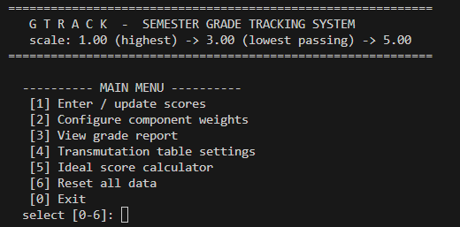
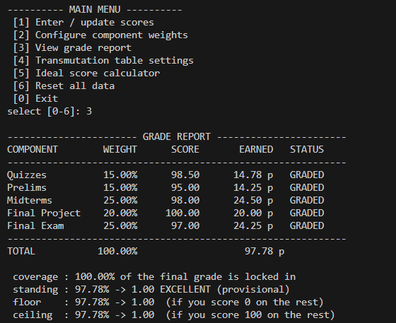

# GTrack – Semester Grade Tracking System

GTrack is a Java-based, menu-driven semester grade tracker that runs in a terminal. It lets a student record assessment scores, configure the percentage weight of each course component, view a running grade report, adjust the grade transmutation table, and estimate the average needed on remaining assessments to reach a target grade point.

## Project Description

The application organizes a course grade into weighted components. It calculates the contribution of graded work, the student's current standing, the possible final-grade range, and the score average needed to meet a chosen grade-point target. The program uses a Philippine-style grade-point scale by default and allows the user to edit the percentage thresholds.

## Problem Being Addressed

Students may find it difficult to keep track of several assessment scores, understand how each assessment affects their overall grade, and estimate what they need to earn on unfinished work. GTrack brings these calculations together in one terminal application.

## Project Objectives

- Record and update scores for the course's grading components.
- Calculate weighted contributions and the current standing from graded components.
- Show the portion of the final grade that is graded and the portion still pending.
- Estimate the lowest and highest possible final percentages based on remaining work.
- Allow users to configure component weights, provided the weights total 100%.
- Allow users to edit the grade transmutation thresholds while keeping the rows in valid order.
- Calculate the average needed across remaining components to reach a selected grade-point target.

## Target Users

The intended users are students who want to monitor their semester standing and estimate the scores needed on remaining assessments. The program may also be used as a small demonstration of object-oriented programming and weighted-grade calculations.

## Main Features

1. **Enter or update scores** – Record scores for quizzes, prelims, midterms, the final project, and the final exam. Quizzes can contain multiple scores (up to 20 by default).
2. **Configure component weights** – Change the percentage weight of each component. An update is accepted only when all weights add up to 100%.
3. **View a grade report** – Display each component's weight, score average, earned contribution, and graded or pending status.
4. **View current standing** – Calculate the average for graded components only, so ungraded components do not lower the displayed standing.
5. **View the possible final-grade range** – Show the current floor (assuming 0% on all pending components) and ceiling (assuming 100% on all pending components).
6. **Edit the transmutation table** – Change the minimum percentage for a grade point. The 5.00 failing-grade floor is fixed, and editable thresholds are restricted so they remain in descending order.
7. **Calculate an ideal score** – Estimate the average required across the remaining components to reach a valid target grade point.
8. **Reset the semester data** – Restore the default components and weights, clear scores, and restore the standard transmutation table.
9. **Validate user input** – Re-prompt when an entered number is invalid or outside the accepted range.

### Default Grading Components

| Component | Default weight |
|---|---:|
| Quizzes | 20% |
| Prelims | 15% |
| Midterms | 20% |
| Final Project | 20% |
| Final Exam | 25% |
| **Total** | **100%** |

The quiz component accepts up to 20 quiz scores by default. Prelims, midterms, final project, and final exam each accept one score. For a single-score component, entering `-1` clears its saved score.

### Default Transmutation Table

| Grade point | Minimum percentage |
|---:|---:|
| 1.00 | 97% |
| 1.25 | 94% |
| 1.50 | 91% |
| 1.75 | 88% |
| 2.00 | 85% |
| 2.25 | 82% |
| 2.50 | 79% |
| 2.75 | 76% |
| 3.00 | 75% |
| 5.00 | 0% (fixed failing-grade floor) |

## Technologies Used

- **Java** – application logic and object-oriented design.
- **Java standard library** – `ArrayList`, `List`, `Collections`, `Map`, `LinkedHashMap`, `HashMap`, and `Scanner` for collections, grade-table management, and console input.
- **JDK 8 or newer** – required to compile and run the source files.
- **Git and GitHub** – recommended for version control and project collaboration.

## Team Members and Roles

Replace the placeholders below with your actual team details before submitting the repository.

| Team member | Role / responsibility |
|---|---|
| `[Member 1]` | `[e.g., project lead / integration]` |
| `[Member 2]` | `[e.g., grade calculations / testing]` |
| `[Member 3]` | `[e.g., documentation / UML diagram]` |
| `[Member 4]` | `[e.g., interface / presentation]` |

Remove unused rows or add more rows to match your team.

## OOP Concepts Demonstrated

- **Encapsulation** – Classes keep fields such as component names, weights, scores, and transmutation rows private and expose methods to read or update them.
- **Abstraction** – `GradeComponent` defines the shared structure and behavior of a graded component, while `GradeTracker.Screen` defines the common behavior of a menu screen.
- **Inheritance** – `SingleScoreComponent` and `MultiScoreComponent` extend `GradeComponent`. The menu-screen classes inside `GradeTracker` extend `Screen`.
- **Polymorphism** – Each grade-component subclass provides its own `enterScores()` behavior. `GradeTracker` invokes `show()` through `Screen` references, allowing each screen subclass to perform its own task.
- **Composition** – `GradeBook` manages its grade components and transmutation table, bringing the grading data and calculations together.

## Instructions for Running the Program

### Requirements

Install a Java Development Kit (JDK), version 8 or newer. To verify that Java is available, open a terminal or command prompt and run:

```bash
java -version
javac -version
```

### Compile and Run

1. Download or clone this repository.
2. Open a terminal or command prompt in the repository's main folder.
3. Move into the `src` folder:

   ```bash
   cd src
   ```

4. Compile all Java source files:

   ```bash
   javac *.java
   ```

5. Start the application:

   ```bash
   java GradeTracker
   ```

6. Follow the numbered menu. Choose `0` to exit.

### Main Menu

| Option | Action |
|---:|---|
| 1 | Enter / update scores |
| 2 | Configure component weights |
| 3 | View grade report |
| 4 | Transmutation table settings |
| 5 | Ideal score calculator |
| 6 | Reset all data |
| 0 | Exit |

To return to the repository's main folder after running the program, enter `cd ..`.

## Sample Screenshots

**Main Menu**



**Grade Report**



- The transmutation-table settings.
- The ideal-score calculator showing a target grade point.


## Known Limitations

- Scores and settings are kept in memory only. They are not saved to a file or database, so they are lost when the application exits.
- The available grading components and the maximum quiz count are defined in the source code; users cannot add or remove components from the menu.
- The application uses a text-based terminal interface and does not have a graphical user interface.
- The default component weights and transmutation thresholds reflect the values currently defined in the source code; users should confirm that these match their instructor's grading policy.

## Future Improvements

- Save and load grades so that data remains available between sessions.
- Allow users to add, remove, and rename grading components from the application.
- Support multiple courses or semesters.
- Add automated unit tests for grade calculations and input validation.
- Provide a graphical user interface or a web-based version.
- Export grade reports to CSV or PDF.

## Project Contributors

Add the full names of everyone who contributed to the project. Keep this list consistent with the **Team Members and Roles** section above.

- `[Contributor 1]`
- `[Contributor 2]`
- `[Contributor 3]`
- `[Contributor 4]`

---

**Project name:** GTrack – Semester Grade Tracking System  
**Application type:** Java console application
